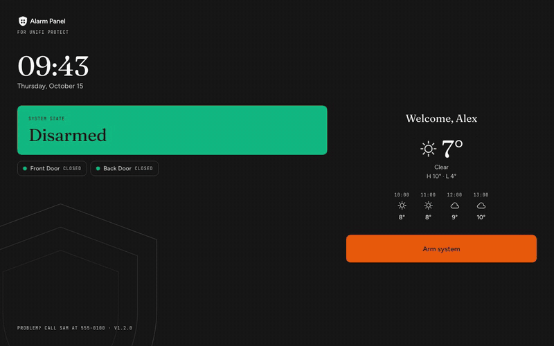
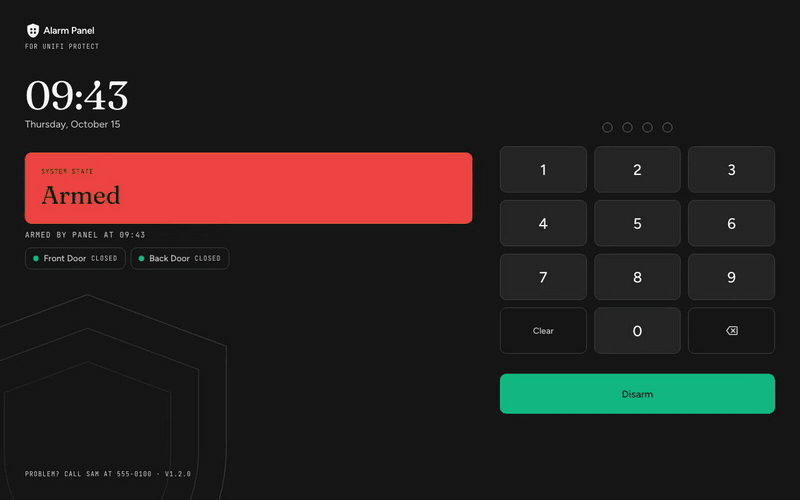
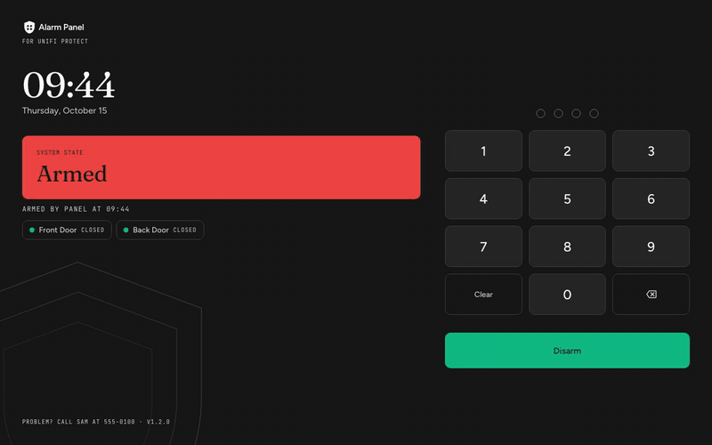
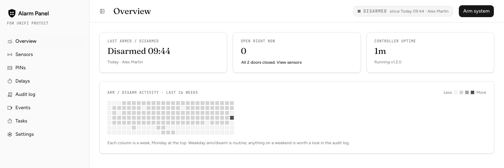
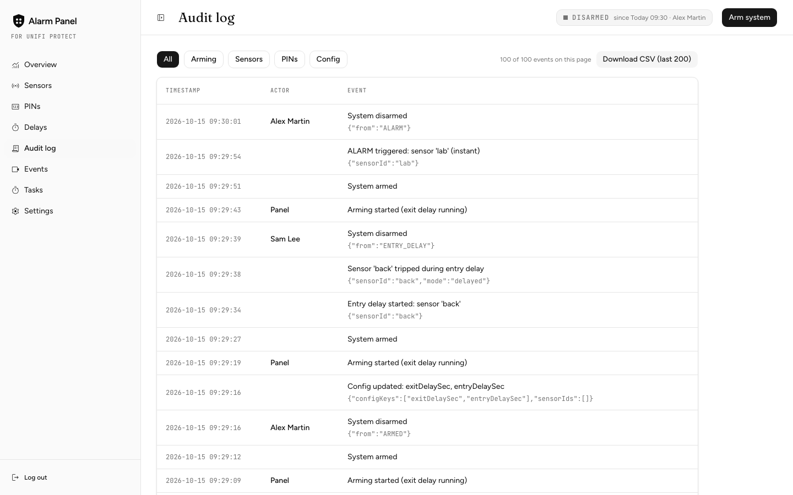
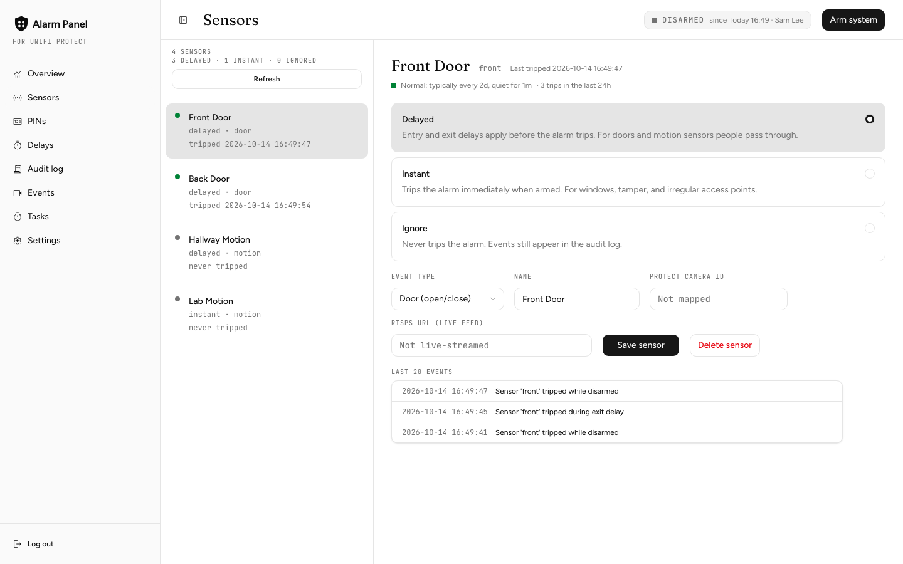

<p align="center">
  
</p>

<h1 align="center">UniFi Alarm Panel</h1>

<p align="center">
  A self-hosted alarm panel for UniFi Protect.<br>
  A PIN keypad on a wall tablet, entry and exit delays, per-person PINs, a duress PIN, an audit log, and alerts to Slack, ntfy, Telegram or Signal.
</p>

<p align="center">
  <a href="https://github.com/FelixLeChat/unifi-alarm-panel/actions/workflows/ci.yml"></a>
  <a href="https://github.com/FelixLeChat/unifi-alarm-panel/releases/latest"></a>
  <a href="https://felixlechat.github.io/unifi-alarm-panel/"></a>
  <a href="LICENSE"></a>
</p>

| Arming | Entry delay | Alarm |
| --- | --- | --- |
|  |  |  |

| Overview | Audit log | Sensors |
| --- | --- | --- |
|  |  |  |

Not affiliated with Ubiquiti. UniFi is a trademark of Ubiquiti Inc.

## Why this exists

UniFi Alarm Manager handles the sensors, arming and notifications. What it doesn't have is the human side of an alarm at the door: someone walks in, a countdown starts, they type their own PIN, and the system knows who disarmed it. This app adds that layer and keeps UniFi for what it does well (sensors, cameras, the console).

- Arm with a tap at the door, no code needed to leave. Disarm with a personal 4-digit PIN.
- Entry and exit delays per sensor, a door-open check before arming, and a real `ALARM` with a camera snapshot in the alert.
- A duress PIN that disarms normally but alerts admins silently.
- An append-only audit log of who armed, who disarmed and what tripped.
- No monitoring subscription and no cloud service. Everything runs on your LAN.

## Quick start

You need a UniFi console with Protect, a Linux host or container host on the same LAN, and a tablet for the wall.

```bash
git clone https://github.com/FelixLeChat/unifi-alarm-panel.git
cd unifi-alarm-panel
cat > .env <<EOF
ADMIN_TOKEN=$(openssl rand -hex 24)
WEBHOOK_SHARED_SECRET=$(openssl rand -hex 24)
SECRETS_KEY=$(openssl rand -base64 32)
EOF
docker compose up -d
```

Open `http://<this-host>:3000/admin`, sign in with `ADMIN_TOKEN`, and the setup wizard walks you through the console connection, notifications and the kiosk. Then point the tablet at `http://<this-host>:3000/panel`.

Keep a copy of `SECRETS_KEY`: without it, stored credentials have to be re-entered. Run one app container only, the alarm's timers live in that process.

On Proxmox VE, one command creates the container and installs everything: see [docs/INSTALL.md](docs/INSTALL.md), which also covers systemd on a bare box.

## How it works

**Arming lives on this server, not in UniFi.** UniFi (Alarm Manager) is an event source and camera layer. It webhooks every sensor trip to this app, which owns the armed/disarmed state, the PINs, the audit log and the alert logic. Adopting sensors forces Alarm Manager into "Global" mode, where arm/disarm isn't reliably controllable through the API, and this design gives per-person accountability.

UniFi's own arm state is mirrored into this app when someone arms from the console, but it never overrides a local change. See [docs/UNIFI.md](docs/UNIFI.md).

One Next.js and TypeScript app serves the kiosk (`/panel`), the admin UI (`/admin`) and the API as a single long-lived Node process, with SQLite for state. A restart partway through a countdown still escalates to `ALARM` on the original schedule.


Open [docs/architecture/how-it-works.html](docs/architecture/how-it-works.html) in a browser for an interactive version that traces routes and exports the diagram.

## Features

- **Kiosk:** door list in every state, countdown that grows in the last 10 seconds, sounds with quiet hours, PIN lockout that raises `ALARM`, weather strip.
- **Alerts:** Slack, ntfy, Telegram and Signal, each with its own routing for Alarm, Duress and Health, snapshots from Protect, and a per-channel test button.
- **Admin:** Overview, Sensors, PINs, Delays, Audit log, Events, Tasks and Settings, plus a first-run setup wizard. Live camera view through go2rtc.
- **UniFi:** webhook and realtime-stream intake, console arm-state sync, device health, a watchdog for a silent sensor feed.
- **Hardening:** credentials encrypted at rest, throttled admin and webhook guards, CSP, `pnpm audit` in CI.

## Tested with

- [UniFi Dream Machine Pro](https://ca.store.ui.com/ca/en/products/udm-pro), Protect 7.x
- [UP-Sense](https://ca.store.ui.com/ca/en/products/up-sense) sensors (door and motion mode) over Bluetooth through an access point
- [G5 Turret Ultra](https://ca.store.ui.com/ca/en/category/physical-security-dome-turret/products/uvc-g5-turret-ultra?variant=uvc-g5-turret-ultra) cameras for snapshots and live view
- An [Amazon Fire HD 10 tablet](https://www.amazon.ca/Amazon_Fire_HD_10_tablet/dp/B0BT752BRT) (amazon.ca) running `/panel` fullscreen in [Fully Kiosk Browser](https://www.fully-kiosk.com/)
- The server: any Linux box or container host on the same LAN as the console

## Possible improvements

- Tie arm and disarm to UniFi Access, for example a [G3 Fingerprint reader](https://ca.store.ui.com/ca/en/category/door-access-readers/collections/access-reader-fingerprint/products/ua-g3-fingerprint) at the door, so a fingerprint can disarm without typing a PIN on the panel.

## Documentation

Read it as a site: **[felixlechat.github.io/unifi-alarm-panel](https://felixlechat.github.io/unifi-alarm-panel/)**. The same pages live in [docs/](docs/).

| Doc | What it covers |
|---|---|
| [INSTALL.md](docs/INSTALL.md) | Docker Compose and systemd installs |
| [CONFIGURATION.md](docs/CONFIGURATION.md) | Settings, alert channels and routing, upgrade notes, advanced keys |
| [UNIFI.md](docs/UNIFI.md) | Sensor-event sources, arm-state sync, camera streaming |
| [SIGNAL.md](docs/SIGNAL.md) | Signal alerts through signal-cli-rest-api |
| [OPERATIONS.md](docs/OPERATIONS.md) | Audit log, backups, watchdog, TLS |
| [RUNBOOK.md](docs/RUNBOOK.md) | One page for whoever is on call |
| [DEVELOPMENT.md](docs/DEVELOPMENT.md) | Repo layout, running it locally, faking UniFi |

## Contributing and support

Bug reports, ideas and pull requests are welcome. [CONTRIBUTING.md](CONTRIBUTING.md) says where to start and what a good pull request looks like. Questions and ideas go in [Discussions](https://github.com/FelixLeChat/unifi-alarm-panel/discussions), bugs in [Issues](https://github.com/FelixLeChat/unifi-alarm-panel/issues/new/choose). To report a vulnerability, see [SECURITY.md](SECURITY.md).

## License

[MIT](LICENSE). Third-party notices in [NOTICE](NOTICE).
