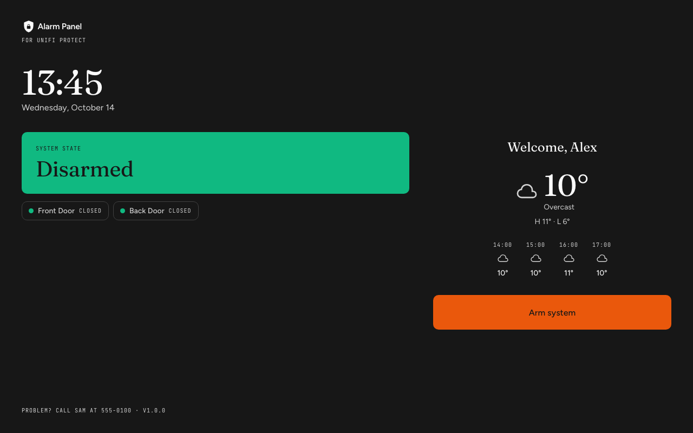
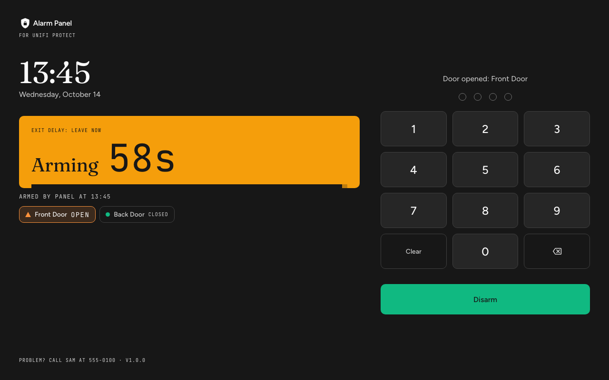
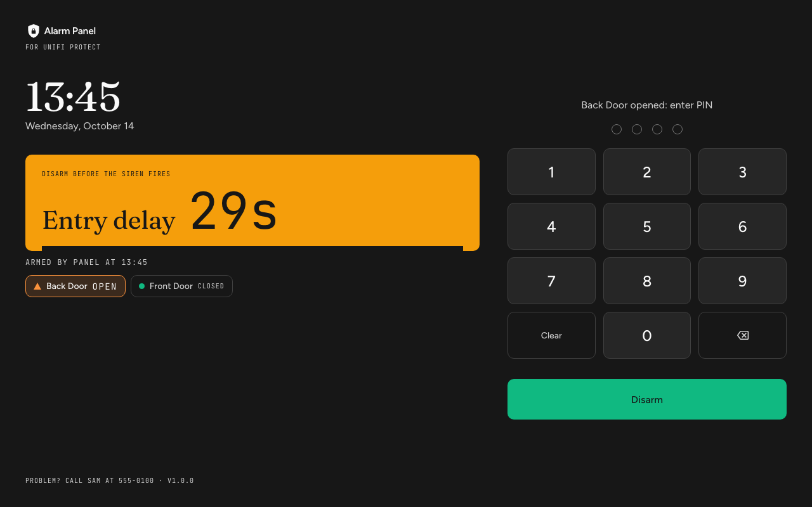
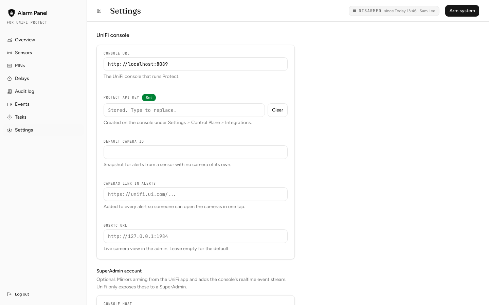
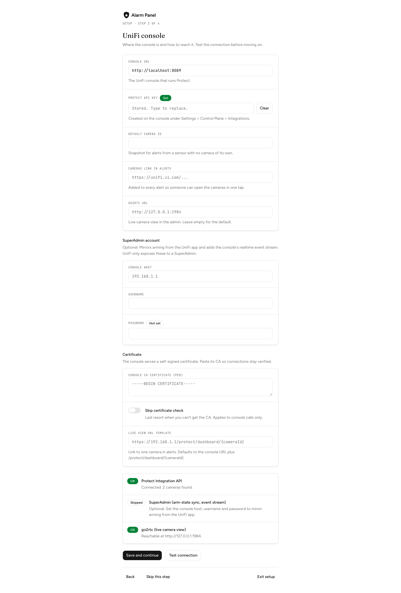

# UniFi Alarm Panel

A self-hosted alarm panel for UniFi Protect: a PIN keypad on a wall tablet, entry and exit delays, per-person PINs, a duress PIN, an audit log and alerts to Slack or ntfy.

Not affiliated with Ubiquiti. UniFi is a trademark of Ubiquiti Inc.

## Why this exists

UniFi Alarm Manager handles the sensors, arming and notifications. What it doesn't have is the human side of an alarm at the door: someone walks in, a countdown starts, they type their own PIN, and the system knows who disarmed it. This app adds that layer and keeps UniFi for what it does well (sensors, cameras, the console).

- Arm with a tap at the door, no code needed to leave. Disarm with a personal 4-digit PIN.
- Entry and exit delays per sensor, a door-open check before arming, and a real `ALARM` with camera snapshots in the alert.
- A duress PIN that disarms normally but alerts admins silently.
- An append-only audit log of who armed, who disarmed and what tripped.
- No monitoring subscription and no cloud service. Everything runs on your LAN.

## Screenshots

The kiosk panel (`/panel`) on the wall tablet. Open doors are listed under the state banner in every state.

| Disarmed | Exit delay, door left open | Entry delay |
| --- | --- | --- |
|  |  |  |

The admin UI (`/admin`):

| Sensors | Settings |
| --- | --- |
|  |  |

First run: the setup wizard tests the console connection before you move on.



Demo data against the fake console from `pnpm protect:mock`, regenerated with `scripts/screenshots.mts` (the header of that file has the steps).

## The one design decision to understand first

**Arming lives on this server, not in UniFi.** UniFi (Alarm Manager) is an event source and camera layer. It webhooks every sensor trip to this app, which owns the armed/disarmed state, the PINs, the audit log and the alert logic. Adopting sensors forces Alarm Manager into "Global" mode, where arm/disarm isn't reliably controllable through the API, and this design gives per-person accountability.

UniFi's own arm state is mirrored into this app when someone arms from the console, but it never overrides a local change. See [docs/UNIFI.md](docs/UNIFI.md).

## Tested with

- UniFi Dream Machine Pro, Protect 7.x
- UP-Sense sensors (door and motion mode) over Bluetooth through an access point
- G5 cameras for snapshots and live view
- An Amazon Fire HD 10 tablet running `/panel` fullscreen in Fully Kiosk Browser
- The server: any Linux box or container host on the same LAN as the console

## Quick start (Docker)

```bash
git clone https://github.com/FelixLeChat/unifi-alarm-panel.git
cd unifi-alarm-panel
cat > .env <<EOF
ADMIN_TOKEN=$(openssl rand -hex 24)
WEBHOOK_SHARED_SECRET=$(openssl rand -hex 24)
SECRETS_KEY=$(openssl rand -base64 32)
EOF
docker compose up -d
```

Open `http://<this-host>:3000/admin`, sign in with `ADMIN_TOKEN`, and the setup wizard walks you through the console connection, notifications and the kiosk. Then point the tablet at `http://<this-host>:3000/panel`.

`docker-compose.yml` runs the app and go2rtc (live camera view). Data lives in the `data` volume. Run one app container only: the alarm's timers live in that process.

**Update:** `docker compose pull && docker compose up -d`. The admin Tasks screen shows when a release is out.

## Configuration

Three things stay in the environment, because they protect everything else:

| Variable | What it is |
| --- | --- |
| `ADMIN_TOKEN` | Signs in to `/admin` and its API |
| `WEBHOOK_SHARED_SECRET` | What UniFi Alarm Manager sends with each sensor event |
| `SECRETS_KEY` | 32 bytes, base64 (`openssl rand -base64 32`). Encrypts the credentials stored in the database |

Plus the runtime basics: `PORT`, `DATABASE_PATH`, `LOG_LEVEL` and `UPDATE_CHECK_REPO`. See [.env.example](.env.example).

**Everything else is set in the admin UI** (Settings, or the first-run wizard) and stored in the database:

- **UniFi console:** console URL, Protect API key, default camera, cameras link for alerts, go2rtc URL, the optional SuperAdmin account, the console CA certificate or "skip certificate check", the live-view URL template. "Test connection" checks the API key, the SuperAdmin account and go2rtc, and says why one failed.
- **Notifications:** alert timezone, Slack (webhook, optional bot token and channel for snapshots), ntfy (server and topic). "Send test alert" sends one to each channel.
- **Kiosk panel:** help text at the bottom of the kiosk, sounds on or off, quiet hours, weather location.

Credentials (API key, SuperAdmin password, Slack webhook and token) are encrypted with `SECRETS_KEY` (AES-256-GCM) and never returned by any API: the UI only shows whether each is set. Keep a copy of `SECRETS_KEY`. Without it, stored credentials can't be read and have to be re-entered. Database backups hold the encrypted values only.

A save applies without a restart: the Protect client, the notifier and the realtime stream rebuild on their next use.

**Upgrading from an env-only setup:** on first boot, any of the old variables still in the environment (`PROTECT_API_BASE_URL`, `PROTECT_API_KEY`, `SLACK_WEBHOOK_URL`, `PANEL_WEATHER_LAT`, ...) are copied into the database once. After that the database wins and those variables are ignored. Set `SECRETS_KEY` before that boot so credentials can be imported.

## Repo layout

```
app/
  panel/            kiosk UI, server-rendered + public/panel.js (vanilla, no React)
  admin/            admin UI, React + shadcn/ui (eight screens and the setup wizard)
  api/              route handlers (arm/disarm/status/health, sensor webhook, admin API)
lib/
  state/            pure alarm state machine (no I/O, fully unit-tested)
  engine/           singleton wiring timers, persistence, notifier and Protect client to the state machine
  scheduler.ts      named-interval job runner for background tasks
  db/               SQLite connection + migrations
  services/         pins, audit, config, settings + secrets, sensors, notifier (Slack/ntfy), Protect client,
                    go2rtc client, rate-limit, and the scheduled jobs (update-check, connectivity-watchdog,
                    protect-alarm-sync, protect-device-health, protect-event-stream, audit-archive, db-backup)
  auth/             admin-token + webhook-shared-secret guards
components/ui/      shadcn/ui components and the Material Symbols icon modules (see docs/design.md)
scripts/            CLI helpers (pin:add, sensor:trip, protect:mock, generate-sounds.py, screenshots.mts)
public/sounds/      panel sounds (WAV)
deploy/             systemd units, bootstrap/build/update scripts, go2rtc configs, optional Caddyfile
docs/               see below
```

| Doc | What it covers |
|---|---|
| [UNIFI.md](docs/UNIFI.md) | Sensor-event sources, arm-state sync, camera streaming |
| [RUNBOOK.md](docs/RUNBOOK.md) | One page for whoever is on call |
| [design.md](docs/design.md) | Design system and per-surface rules |
| [architecture/](docs/architecture/) | Architecture diagram (mermaid) |
| [sounds/index.html](docs/sounds/index.html) | Listening page for the panel sounds |

One **Next.js + TypeScript** app: API routes, kiosk UI and admin UI. It runs as a single long-lived Node process (`output: "standalone"`, no horizontal scaling) so the server-side timers and in-memory state work. State persists to SQLite for restart recovery.

**Restart recovery covers an in-flight countdown.** `alarm_state` stores the exit/entry deadline next to the state, and the engine re-arms its timer from it on boot. A reboot or an update partway through an entry delay still escalates to `ALARM` on the original schedule (immediately if the deadline passed while the process was down). Look for `resumed an in-flight alarm countdown after a restart` in the log.

## Features

- **Core:** state machine, engine, SQLite, PIN auth with rate-limit/lockout, Slack + ntfy alerts with Protect snapshots, kiosk panel, admin UI, security hardening (CSP, throttled admin/webhook guards, `pnpm audit` in CI).
- **Admin screens:** Overview, Sensors, PINs, Delays, Audit log, Events, Tasks, Settings, plus the first-run setup wizard.
- **UniFi:** webhook plus realtime-stream intake, console arm-state sync, device health, live camera streaming through go2rtc.
- **Panel:** door-open check before arming, exit-delay door chime, event sounds, PIN lockout raises `ALARM`.
  - Every non-ignored door is listed under the banner in every state (open ones first, up to 8), plus "Armed by X at HH:MM" while armed (in memory, so blank after a restart).
  - The countdown grows and pulses in the last 10s, the dim overlay never covers an entry delay or alarm, a PIN shows "Checking…" while it is verified, the second-to-last wrong PIN warns "LAST TRY", and a failing poll marks the countdown "reconnecting".

The Alarm Manager webhook payload shape may need the config-mapped fields in `lib/services/webhook-intake.ts` (`webhookSensorIdPath`, `webhookEventTypePath`) tuned.

## Contributing

See [CONTRIBUTING.md](CONTRIBUTING.md): workflow, commit format, checks, what to be careful with, releases. Security rules are in [CLAUDE.md](CLAUDE.md), and how to report a vulnerability is in [SECURITY.md](SECURITY.md).

## Development

```bash
pnpm install
cp .env.example .env        # set ADMIN_TOKEN, WEBHOOK_SHARED_SECRET and SECRETS_KEY

pnpm test                   # vitest: state machine, engine, services, route handlers
pnpm test:e2e               # playwright: real browser, builds and starts its own server on a fresh DB
pnpm shots:baseline         # screenshot every admin screen, dialog and panel state into visual-baseline/ (gitignored)
pnpm shots                  # same walk, compared against visual-baseline/ (strict colour, 200 stray pixels allowed)
pnpm lint
pnpm exec tsc --noEmit

pnpm dev                    # http://localhost:3000 (/, /panel, /admin)
```

Seed a PIN from the CLI (or use `/admin`):

```bash
pnpm pin:add "Alex" 1234
curl -X POST localhost:3000/api/arm -H 'content-type: application/json' -d '{"pin":"1234"}'
curl localhost:3000/api/status
```

PINs are exactly 4 digits, and a duplicate code is rejected (409).

### Faking UniFi locally

No hardware needed to exercise the full alarm flow:

```bash
pnpm protect:mock                  # fake UniFi Protect on :8089, with viewable placeholder snapshots
pnpm sensor:trip front-door open   # simulates UniFi Alarm Manager's outbound webhook
```

In the setup wizard (or Settings > UniFi console), set the console URL to `http://localhost:8089` and any API key, then "Test connection" lists the mock's two cameras. `sensor:trip` posts to `/api/hooks/sensor` like the real webhook. While armed, it should reach `ALARM` and, if the sensor has a camera mapped (or a default camera is set), pull a snapshot from `protect:mock`. For Slack, use a throwaway [webhook.site](https://webhook.site) URL as the webhook. With no channel set, alerts no-op (that's what the tests use).

A sensor row is created the first time UniFi posts an event naming it. There is no "add sensor" step, and the Sensors screen shows "No sensors found" until one arrives. Then map it to a camera on that screen.

`GET /api/health` reports engine and DB status, the sensor-feed heartbeat age, the running version, and the connectivity watchdog's view (default camera reachability, realtime-stream status and last error, which source delivered the last event).

## Audit log

The `audit` table is append-only (a DB trigger blocks `UPDATE` and `DELETE`), so it is never pruned. The admin Audit log screen pages through it 100 events at a time. Settings changes are logged with the names of the fields that changed, never their values.

A background job (`lib/services/audit-archive.ts`, every 6h) also writes one CSV per completed day to `<directory of DATABASE_PATH>/audit-archive/audit-YYYY-MM-DD.csv`. It's a convenience export for grep or a spreadsheet, not a retention mechanism.

## Backups

The SQLite file (`DATABASE_PATH`) is the only datastore: every PIN, the audit history, settings, config and sensor mappings. `lib/services/db-backup.ts` runs once on boot, then every 24h. It writes a snapshot to `<directory of DATABASE_PATH>/backups/alarm-YYYY-MM-DD-HHmm.db` through SQLite's online backup API (safe with WAL, no need to stop the service) and keeps the 14 most recent.

To restore, stop the service, copy a backup over the live file, restart:

```bash
sudo systemctl stop unifi-alarm-panel
cp /path/to/data/backups/alarm-2026-09-01-0300.db /path/to/data/alarm.db
sudo systemctl start unifi-alarm-panel
```

Backups sit on the same disk as the live DB. They cover a bad deploy or a botched edit, not the box dying. Copy `backups/` off-box periodically (not automated), and keep `SECRETS_KEY` somewhere separate from them.

## Advanced config keys

The admin Settings screen has a typed "Security" section for the PIN, admin-token and webhook-secret lockout: `rateLimitMaxAttempts` (default 5), `rateLimitWindowSec` (300, failures older than this stop counting) and `rateLimitLockoutSec` (300). An "Advanced" table lists every other config row, so any key below is editable there or through `PUT /api/admin/config`.

- `webhookSensorIdPath` / `webhookEventTypePath`: how `POST /api/hooks/sensor` reads a nonstandard payload.
- `cameraTriggerEventTypes`: comma-separated event types (e.g. `motion`) meaning the device UniFi named is the camera itself, not a sensor. The device self-maps to its own camera id. Unset by default, since it depends on what your console sends.
- `sensorOpenEventTypes` / `sensorClosedEventTypes`: comma-separated event types meaning a door just opened or closed. They drive a sensor's `current_state`. Unset by default. **Until they hold real values from your console, `current_state` stays `NULL` and the door check does nothing.**
- `sirenAlarmManagerWebhookId`: id of an Alarm Manager *inbound* webhook automation (Alarm Manager → Automations → "Receive a webhook"), for example a PoE siren. This app POSTs to it once, only when the state machine reaches `ALARM`, never on a duress disarm. A failed trigger is logged and never blocks the Slack/ntfy alert.
- `defaultSensorMode`: the mode (`delayed` / `instant` / `ignore`) a sensor gets the first time it appears. Defaults to `delayed`, so an unknown sensor starts the entry delay instead of alarming at once. Use `delayed` for doors and motion sensors people legitimately pass through, and `instant` for windows, tamper and irregular access points nobody should use while armed.
- `externalArmSyncDelaySec`: the short countdown used when arming is detected through the console sync (default 5). See [docs/UNIFI.md](docs/UNIFI.md).

## Door check on arming

Arming (from the panel or admin) is blocked while any sensor with `sensorType: "door"` and a mode other than `ignore` is open, per its `current_state`. The response names the open sensors. Submitting again sends `force: true`, which arms anyway and logs `arm_forced_with_sensors_open` (a normal block logs `arm_rejected_sensors_open`).

A door sensor tripping during the exit delay plays a distinct chime on the panel. Motion sensors don't. The console sync is not gated by this check.

## Panel sound

The kiosk plays short WAVs from `public/sounds/`. They are rendered by `python3 scripts/generate-sounds.py`, and [docs/sounds/index.html](docs/sounds/index.html) is the page used to pick them. Events: key and backspace, arm confirmed, exit-delay beat, door-open chime, armed, arm refused, entry-delay beat, disarm success, wrong PIN, lockout, and the looping alarm. Both countdown beats run once a second and double up near the end (last 5s of the exit delay, last 10s of the entry delay). A door opened during the exit delay is named on the panel (`armingTripDoors` in `/api/status`). A duress PIN sounds exactly like a normal disarm.

- **Kiosk sounds** (Settings > Kiosk panel, default on) mutes everything.
- **Test mode** (Settings, config key `panelTestMode`): for a trial period. The alarm runs every normal step (state changes, Slack and ntfy alerts, snapshots, the UniFi siren webhook) but only the kiosk siren (the looping alarm tone) is muted, every other sound still plays, and a "Test mode — siren off" banner shows. It rides on the 2s `/api/status` poll (`testMode`), so a toggle lands within seconds and also stops a siren already sounding. The UniFi-side siren still fires.
- **Quiet hours** (Settings > Kiosk panel, default 22 to 6) silence everything in that window, except the alarm. Quiet hours also dim the screen (tap to wake).
- Web Audio stays silent after a page reload until someone taps. With Fully Kiosk's **Enable JavaScript Interface (PLUS)** on, the alarm plays through `fully.playSound` instead (looped, no tap needed), and so do the other sounds until the first tap unlocks Web Audio.

## PIN lockout

Wrong PINs show the remaining attempts. The attempt that tips into lockout also raises a real `ALARM`, whatever the arm state. Repeated wrong PINs at the physical keypad are the one signal here that is alarming on their own. PIN entry auto-submits on the 4th digit.

## Deployment without Docker (systemd)

Runs directly on a Linux box, LXC container or VM under systemd. Releases ship prebuilt: `.github/workflows/release.yml` attaches a standalone tarball to every `v*` tag's GitHub Release (and pushes the Docker image). The box downloads it, so there is no pnpm and no native-module compile on the box.

**Requirements:** Node.js 22 LTS or newer (tested on 26.x) and `jq` (`deploy/bootstrap.sh` installs it).

```bash
# On the box, as a normal user with sudo:
git clone https://github.com/FelixLeChat/unifi-alarm-panel.git /opt/unifi-alarm-panel
cd /opt/unifi-alarm-panel

./deploy/bootstrap.sh   # one-time, idempotent: "uap" system user, dirs, jq

cp .env.example /etc/unifi-alarm-panel.env
$EDITOR /etc/unifi-alarm-panel.env   # ADMIN_TOKEN, WEBHOOK_SHARED_SECRET, SECRETS_KEY
sudo chmod 600 /etc/unifi-alarm-panel.env

./deploy/update.sh v1.0.0   # omit the tag for the latest release

sudo cp deploy/unifi-alarm-panel.service /etc/systemd/system/
sudo systemctl daemon-reload
sudo systemctl enable --now unifi-alarm-panel
sudo journalctl -u unifi-alarm-panel -f

# Optional but recommended: lets the admin UI's "Update available" banner apply the update
sudo cp deploy/unifi-alarm-panel-updater.service deploy/unifi-alarm-panel-updater.timer /etc/systemd/system/
sudo systemctl daemon-reload
sudo systemctl enable --now unifi-alarm-panel-updater.timer
```

Then finish the setup wizard at `http://<this-box>:3000/admin`.

A GitHub token is only needed to download releases from a private fork: put a fine-grained PAT with "Contents: Read-only" in `/etc/unifi-alarm-panel-github-token` (chmod 600, owned by `uap`).

**Update:** `./deploy/update.sh [tag]`. It downloads the tarball into `releases/<tag>/`, flips the `current` symlink and restarts. Roll back the same way with an older tag. The last 5 releases stay on disk, so a rollback is a symlink flip and a restart.

**Auto-update from the admin UI:** the app checks GitHub hourly (`lib/services/update-check.ts`) and shows an "Update available" banner. Clicking it only drops the target tag into the state dir, because `unifi-alarm-panel.service` runs unprivileged on purpose (no sudo, `ProtectSystem=strict`). `unifi-alarm-panel-updater.timer` (root, every minute) runs the real `update.sh` and restarts. Without the timer, the banner still tells you a release is out and you run `update.sh` yourself. In Docker the banner is hidden and Tasks says to pull the new image.

**Live camera view:** go2rtc runs next to the app. With systemd, see `deploy/install-go2rtc.sh`, `deploy/go2rtc.yaml` and `deploy/unifi-alarm-panel-go2rtc.service`.

## Operations

**Watchdog:** `lib/scheduler.ts` runs a connectivity watchdog every 5 minutes. It checks the sensor-feed heartbeat and, if a default camera is set, that camera's reachability. A Slack/ntfy `HEALTH` alert fires once when the feed goes 2h without an event and the realtime stream isn't connected. See [docs/UNIFI.md](docs/UNIFI.md).

**SuperAdmin account:** the console host, username and password of a SuperAdmin local account (Settings > UniFi console) turn on the arm-state sync, the realtime stream and device health. All three are no-ops without it.

**Console self-signed cert:** paste the console's CA certificate in Settings > UniFi console, or turn on "Skip certificate check" as a last resort. Do **not** set `NODE_TLS_REJECT_UNAUTHORIZED=0`. It disables certificate verification for the whole process (Slack, ntfy, the GitHub update check), and the realtime stream ignores it anyway.

**Optional LAN TLS:** `apt install caddy`, then drop `deploy/Caddyfile` in as `/etc/caddy/Caddyfile`. It reverse-proxies to `localhost:3000` with a self-signed cert. The panel and the webhook both work over plain HTTP on a trusted LAN.

**Point UniFi Alarm Manager's webhook** at `http://<this-box>:3000/api/hooks/sensor` with the shared secret in an `X-Alarm-Secret` header, once you've tripped a sensor and confirmed the payload shape. Prefer the header. The `?token=<WEBHOOK_SHARED_SECRET>` form still works for consoles that can't set one, but a secret in a URL lands in the access log of any proxy added later.

## License

[MIT](LICENSE). Third-party notices in [NOTICE](NOTICE).
